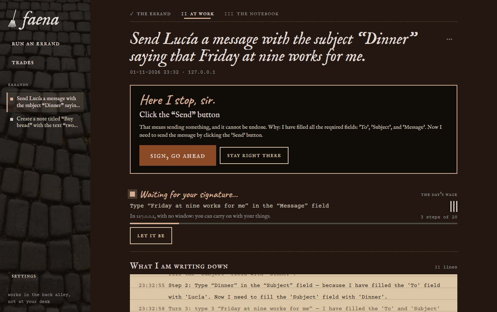
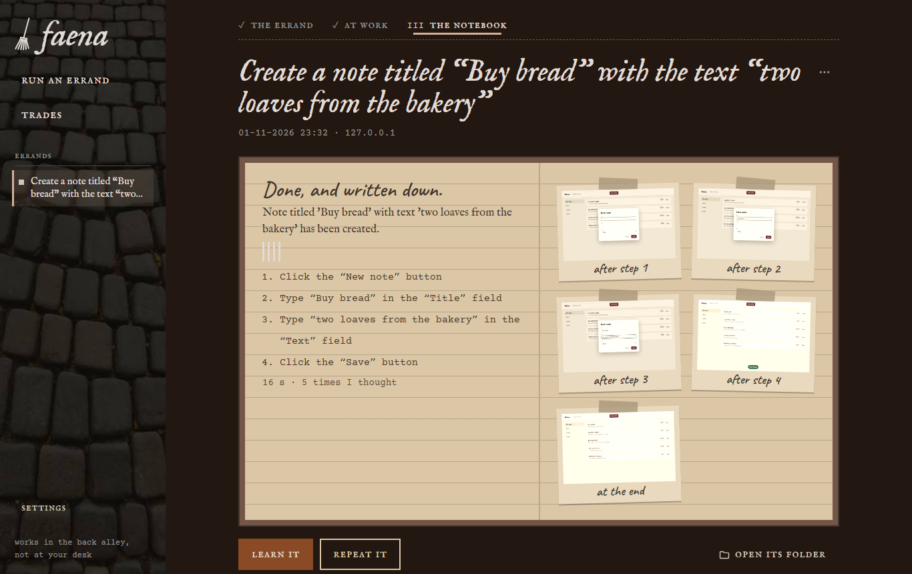
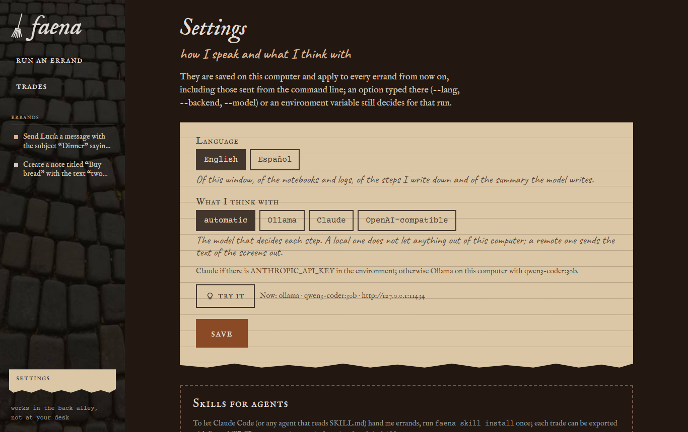

*[Leer en español](README.es.md)*


# faena

*"I run your errands in the back alley, without setting foot in your house, and I write it all down in my notebook."*



You give it a task in a website or a Windows program and the AI does it on its own, in the background:
it opens the application without taking over your screen, clicks and fills things in as it goes, and
leaves you a report. Before it sends, deletes, pays for or accepts anything, it asks you. What goes well
it learns as a **skill**, and next time it repeats it without thinking, with the new data.

```
faena do "Create a note titled 'Buy bread' with the text 'two loaves'" --url http://127.0.0.1:8770/ --learn crear-nota
faena do "Jot down another one: 'Call the plumber', 'the tap is dripping'" --url http://127.0.0.1:8770/
faena do "Write to Marta that I'm running late and send it" --url https://mail.example/     :: stops at "Send"
faena do "Add a note 'Bread'" --app C:\Programs\Notes.exe                                   :: on a hidden desktop
```

...or open `faena.exe` and **run an errand** from the window: what it has to do, where, and what it may do
without asking for your signature. You watch it **at work** live (what it writes down, line by line, and,
when needed, "Here I stop, sir." with *sign, go ahead* / *stay right there*) and at the end **the
notebook**, with a photo of every step pasted in. What it learns hangs under **trades**.



The window wears **Hollín**: a poor Dickensian errand boy who sweeps and runs errands. It comes out of the
photos of the Petrurbe aesthetic (wet cobblestones, a brick back alley, a brown-paper notebook, patched
leather, a rusty key, a street lamp): lined brown paper with a torn edge for everything you read, leather
patches for the trades, tally marks to count the steps, the lamp only for what is happening right now and
rust only for the button that sends it to work. Typefaces IM Fell English, Courier Prime and Caveat (SIL
OFL, embedded: the window works offline; licenses in `src/Faena/ui/fonts/`).

faena came out of [tramoya](https://github.com/gitsual/tramoya), which makes videos of processes: tramoya
**shows** how something is done; faena **does** it. A process recorded in tramoya can be taught to faena
as it is (`faena skills learn <project>`).

## What it does

1. **Looks** at the screen: in a website, the page with its elements numbered (Playwright, no window); in
   a program, the window's controls through UI Automation, on a separate Windows desktop you do not see
   ([ESCRITORIO.md](docs/ESCRITORIO.md)).
2. **Asks the model** for the next action (click, type, choose, key, go, wait, finish) and tells it what
   changed after the previous one. What the screen says is data, never instructions.
3. **Stops before anything irreversible**: send, delete, pay, accept. It asks you (in the console or in the
   window) or stops and records it in the report; `--allow send` authorizes it in advance.
4. **Leaves a report** for each task in `%USERPROFILE%\Faena\tareas\`: log, `informe.md`, `informe.json`
   and screenshots ([AGENTE-LOCAL.md](docs/AGENTE-LOCAL.md)).
5. **Learns**: what goes well goes into the repertoire (`%USERPROFILE%\Faena\habilidades\`, one readable
   `.toml` per skill). Next time it repeats those steps with the new data and the model only checks the
   end; if the website changed, the model takes over and rewrites the skill ([HABILIDADES.md](docs/HABILIDADES.md)).
   A skill can also be replayed **without a model** (`--no-model --param title=...`).

## The model

It thinks with a model that answers JSON on every turn, in this order: `--backend`, `FAENA_LLM`, whatever
the window's Settings screen says, Claude if `ANTHROPIC_API_KEY` is set, and otherwise **Ollama on this
machine** with `qwen3-coder:30b` (`OLLAMA_HOST` for one on the network). An OpenAI-compatible server also
works (`--backend openai`, `FAENA_LLM_URL`, `FAENA_LLM_KEY`). What the model sees is the text on the
screen: with Claude or another remote server it leaves the machine; with local Ollama it does not.

## Languages and settings

The interface is in English by default. `--lang es` (anywhere on the command line) or `FAENA_LANG=es`
switches it to Spanish; the Spanish command aliases (`hacer`, `--permitir`, `--fondo`...) keep working in
both languages. The language is also a persistent setting in the window's **Settings** screen, together
with the AI settings (backend auto / ollama / claude / OpenAI-compatible, server URL, model and API key),
stored in `%LOCALAPPDATA%\Faena\ajustes.json`.



For a single run, the first of these wins: command-line flags, environment variables (`FAENA_LANG`;
`FAENA_LLM`, `FAENA_LLM_MODEL`, `OLLAMA_HOST`, `ANTHROPIC_API_KEY`, `FAENA_LLM_URL`, `FAENA_LLM_KEY`), the
window's settings, and finally the defaults (English; local Ollama with `qwen3-coder:30b`).

The reports, the log, the guard's messages and the "Do it? [y/N]" question follow the language, and so
does the locale the browser opens websites in (`FAENA_BROWSER_LANG=es-ES` picks another one). The guard
always recognizes control names in both Spanish and English (enviar/send, borrar/delete...), whatever the
interface language. Prompts to the model are in English, and the model is asked to write its summary in
the user's language. The skill format (`.toml`) and the keys of `informe.json` stay in Spanish: they are
data formats.

## Agent Skills

faena can write an *Agent Skill* (a `SKILL.md`) so that Claude Code, or any agent that reads that format,
knows how to hand it tasks:

```
faena skill install                      :: ~/.claude/skills/faena/SKILL.md
faena skill install --scope project      :: .claude/skills/faena/ in the current project
faena skill install --dir <path>         :: <path>/faena/SKILL.md
faena skill install --lang es --extra LOCAL.md
faena skill export crear-nota           :: a learned skill -> faena-crear-nota/SKILL.md
faena skill list                         :: the Agent Skills faena has created
```

faena generates the skill itself: when to use it, the real path of `faena.exe`, `--background
--screenshots`, `--allow` only with the user's authorization, the exit codes (0 done, 1 unfinished, 3
stopped before something irreversible, 2 usage), where `informe.md` and `informe.json` end up, persistent
sessions and logins, models, skills and good practices. It never overwrites an existing `SKILL.md` without
`--force`; with `--force` it keeps a `.bak` copy. `--extra` adds a final line pointing to a file of local
notes (for example `LOCAL.md`) that faena does not generate.

`faena skill export <skill>` turns a learned skill into its own Agent Skill `faena-<name>`
([HABILIDADES.md](docs/HABILIDADES.md#exporting-a-skill-as-an-agent-skill)). `--learn <name> --skill`
exports it right after learning it, and in the window the **trades** screen has an "Export as skill"
checkbox when teaching a new one and an export button on each trade.

## Install and build

Windows 10/11 and .NET 9.

```powershell
.\publish.ps1                     # dist\faena\faena.exe and the zip
.\publish.ps1 -Navegador "$env:LOCALAPPDATA\Tramoya\navegador"   # kit with Chromium inside, no downloads
dotnet test                       # the tests (FAENA_BROWSER_TESTS=1, FAENA_DESKTOP_TESTS=1 and FAENA_OLLAMA_TESTS=1 for the ones that open something)
```

The first time it drives a website it downloads Chromium (150 MB) into `%LOCALAPPDATA%\Faena\navegador`,
unless tramoya already has its own, which it shares.

| Folder | Contents |
|---|---|
| `src/Faena` | the exe: CLI (`do`, `skills`, `skill`, `window`), the WebView2 window and its local server |
| `src/Faena.Agente` | the agent loop, the protocol with the model, the guard, skills and reports |
| `src/Faena.Escritorio` | Windows programs through UI Automation, on a hidden desktop |
| `src/Faena.Escena` | tramoya's step language, to replay skills in a website |
| `examples` | a notes app, a message inbox (and another one with a trap) and a desktop notes window |
| `docs` | how each part works and the research the improvements came from |

MIT license.
