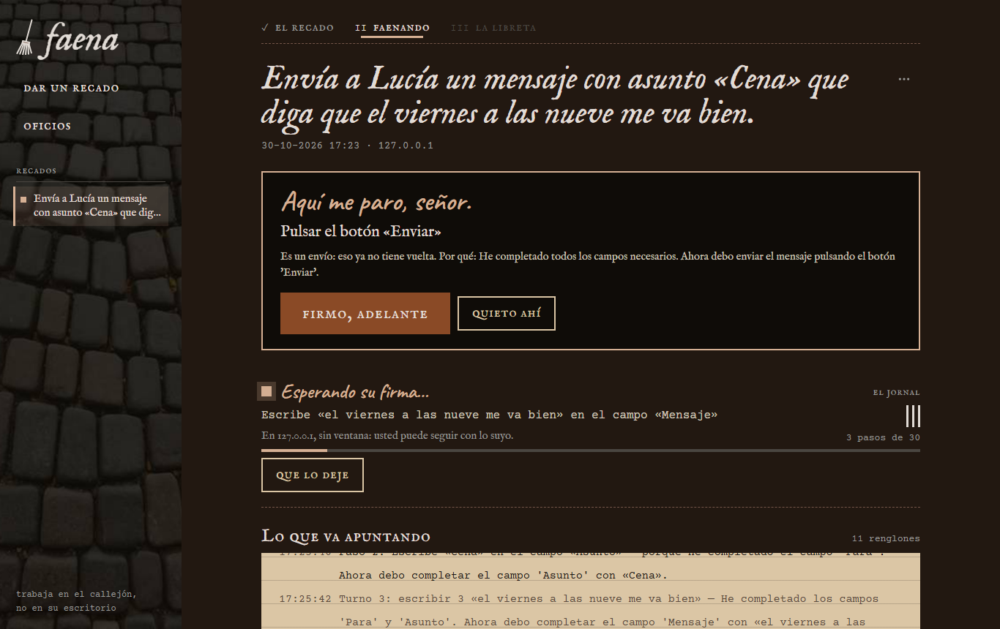
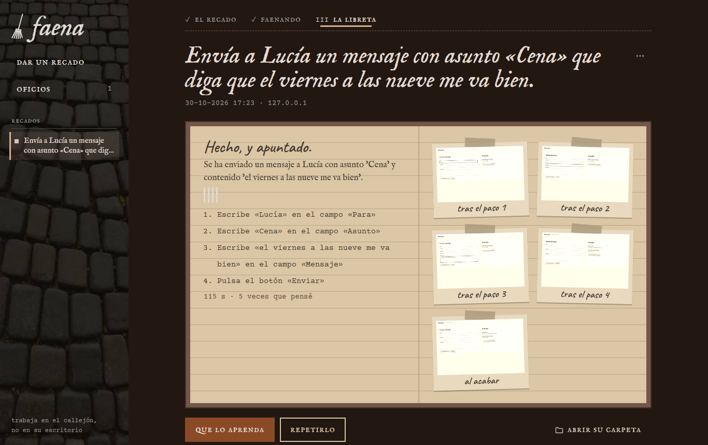

# faena

*«Hago sus recados en el callejón, sin entrar en su casa, y lo apunto todo en la libreta.»*



Le encargas una tarea en una web o en un programa de Windows y la IA la hace sola, en segundo plano:
abre la aplicación sin quitarte la pantalla, va haciendo clics y rellenando, y te deja un informe. Antes
de enviar, borrar, pagar o aceptar nada, te pregunta. Lo que sale bien lo aprende como **habilidad** y la
próxima vez lo repite sin pensar, con los datos nuevos.

```
faena hacer "Crea una nota con título «Comprar pan» y texto «dos barras»" --url http://127.0.0.1:8770/ --aprender crear-nota
faena hacer "Apúntame otra: «Llamar al fontanero», «el grifo gotea»" --url http://127.0.0.1:8770/
faena hacer "Escríbele a Marta que llego tarde y mándaselo" --url https://correo.ejemplo/     :: se para ante «Enviar»
faena hacer "Añade una nota «Pan»" --app C:\Programas\Notas.exe                              :: en un escritorio oculto
```

…o abre `faena.exe` y dale un recado desde la ventana: qué tiene que hacer, dónde y qué puede hacer sin
pedirte firma. Lo ves faenando en directo (lo que va apuntando, renglón a renglón, y, si hace falta,
«Aquí me paro, señor» con *firmo, adelante* / *quieto ahí*) y al final la libreta, con las fotos de cada
paso pegadas. Lo que aprende queda colgado en **oficios**.



La ventana viste **Hollín**: un mozo pobre de Dickens que barre y hace recados. Sale de las fotos de la
estética Petrurbe (adoquín mojado, callejón de ladrillo, cuaderno de estraza, cuero remendado, una llave
oxidada, un farol): papel de estraza con renglones y el borde roto para todo lo que se lee, remiendos de
cuero para los oficios, palotes para contar los pasos, el farol solo para lo que está pasando y el óxido
solo para el botón que manda trabajar. Letra IM Fell English, Courier Prime y Caveat (SIL OFL, incrustadas:
la ventana va sin red; licencias en `src/Faena/ui/fonts/`).

faena salió de [tramoya](https://github.com/gitsual/tramoya), que hace vídeos de procesos: tramoya
**enseña** cómo se hace algo; faena lo **hace**. Un proceso grabado en tramoya se le puede enseñar a faena
tal cual (`faena habilidades aprender <proyecto>`).

## Qué hace

1. **Mira** la pantalla: en una web, la página con sus elementos numerados (Playwright, sin ventana); en
   un programa, los controles de la ventana por UI Automation, en un escritorio de Windows aparte que no
   ves ([ESCRITORIO.md](docs/ESCRITORIO.md)).
2. **Pregunta al modelo** la siguiente acción (clic, escribir, elegir, tecla, ir, esperar, terminar) y
   le cuenta qué cambió tras la anterior. Lo que pone la pantalla son datos, nunca órdenes.
3. **Para ante lo irreversible**: enviar, borrar, pagar, aceptar. Te pregunta (en la consola o en la
   ventana) o se para y lo deja en el informe; `--permitir enviar` lo autoriza de antemano.
4. **Deja un informe** por encargo en `%USERPROFILE%\Faena\tareas\`: registro, `informe.md`, `informe.json`
   y capturas ([AGENTE-LOCAL.md](docs/AGENTE-LOCAL.md)).
5. **Aprende**: lo que sale bien pasa al repertorio (`%USERPROFILE%\Faena\habilidades\`, un `.toml` legible
   por habilidad). La próxima vez repite esos pasos con los datos nuevos y el modelo solo comprueba el
   final; si la web cambió, sigue él y reescribe la habilidad ([HABILIDADES.md](docs/HABILIDADES.md)).
   Una habilidad también se puede repetir **sin modelo** (`--sin-modelo --param titulo=…`).

## El modelo

Piensa con un modelo que contesta JSON en cada turno, por orden: `--backend`, `FAENA_LLM`, Claude si hay
`ANTHROPIC_API_KEY`, y si no **Ollama en este equipo** con `qwen3-coder:30b` (`OLLAMA_HOST` para uno de la
red). Lo que ve el modelo es el texto de la pantalla: con Claude sale del equipo; con Ollama, no.

## Instalar y compilar

Windows 10/11 y .NET 9.

```powershell
.\publish.ps1                     # dist\faena\faena.exe y el zip
.\publish.ps1 -Navegador "$env:LOCALAPPDATA\Tramoya\navegador"   # kit con Chromium dentro, sin descargas
dotnet test                       # las pruebas (FAENA_BROWSER_TESTS=1, FAENA_DESKTOP_TESTS=1 y FAENA_OLLAMA_TESTS=1 para las que abren algo)
```

La primera vez que maneja una web descarga Chromium (150 MB) en `%LOCALAPPDATA%\Faena\navegador`, salvo que
tramoya ya tenga el suyo, que comparte.

| Carpeta | Qué hay |
|---|---|
| `src/Faena` | el exe: CLI (`hacer`, `habilidades`, `ventana`), la ventana WebView2 y su servidor local |
| `src/Faena.Agente` | el bucle del agente, el protocolo con el modelo, el guardián, las habilidades y los informes |
| `src/Faena.Escritorio` | los programas de Windows por UI Automation, en un escritorio oculto |
| `src/Faena.Escena` | el lenguaje de pasos de tramoya, para repetir habilidades en una web |
| `examples` | una app de notas, una bandeja de mensajes (y otra con trampa) y una ventana de notas de escritorio |
| `docs` | cómo funciona cada parte y la investigación de la que salieron las mejoras |

Licencia MIT.
